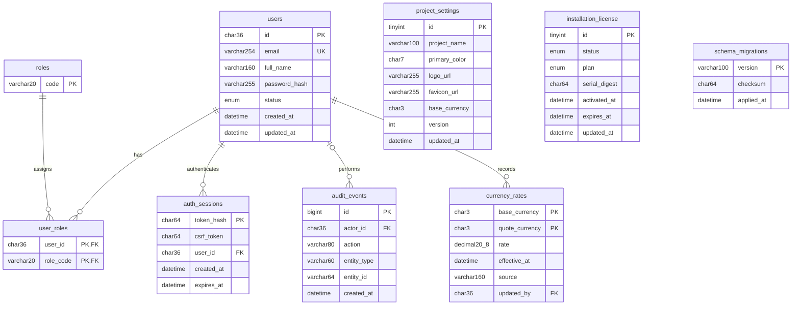

# Database model

Database is `travneeds_crm`. Local XAMPP reports MariaDB 10.4.32. The schema uses MySQL-compatible InnoDB tables, utf8mb4 text, foreign keys and explicit constraints. Initial migration is `docs/database/migrations/001_foundation.sql`.

## Implemented foundation

## Constraints and state

| Table | Ownership and invariant |
| --- | --- |
| users | Authentication/user management. Unique email, UUID identifier, versioned password hash, active/disabled status |
| roles | Technical codes `admin` and `employee` |
| user_roles | Composite primary key prevents duplicate assignments |
| auth_sessions | SHA-256 token digest, CSRF token, absolute 8-hour expiry, FK to user, expiry/user indexes |
| audit_events | Actual login, logout, bootstrap and settings events. Nullable actor preserves events if an account is removed |
| project_settings | Singleton id 1, optimistic version increments with each saved change |
| currency_rates | Positive DECIMAL(20,8), distinct base/quote currencies, real source and effective date, author FK |
| installation_license | Singleton id 1, starts inactive with nullable plan/digest/dates. An active record requires plan, digest and valid dates |
| schema_migrations | Immutable migration version and content checksum |

The migration inserts the two role codes, the actual default project identity, and an inactive license record. It inserts no users, sessions, exchange rates or business records. USD is the initial base-currency configuration and can be changed by an administrator.

Currency-rate ingestion/conversion, serial issuing, activation verification, renewal and license enforcement are deferred. No endpoint currently changes licensing status. The raw activation serial is absent from storage and application logs.

## Future module contracts

Leads, Customers, Suppliers, Bookings and Payments do not yet have tables in this foundation. Their fields and foreign keys will be derived from the selected source modules. The expected domain flow is a Lead associated with a Customer, booking ownership under a Customer, supplier participation in booked services, and payments linked to their booking/customer. Finance reports will read those persisted records once the contracts are implemented.

Each module integration must add a migration and update this diagram with the actual model. Preserve optional and historical relationships explicitly. Monetary values require DECIMAL, currency codes, transaction boundaries and ownership checks. No placeholder booking or payment schema is presented as an implemented workflow.

## Operations

Migrations use a database advisory lock, statement-by-statement execution and a checksum ledger. DDL implicitly commits on MariaDB, so an interrupted migration is rerun using idempotent statements. Never edit a migration after it has been applied. The runtime account uses DML permissions on this database. Schema and account setup use the separate operational credentials.
