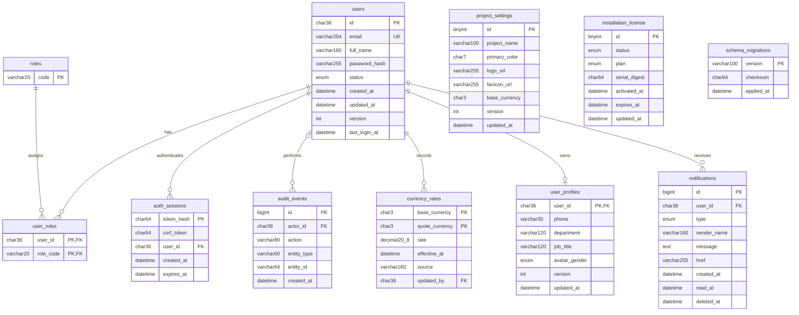
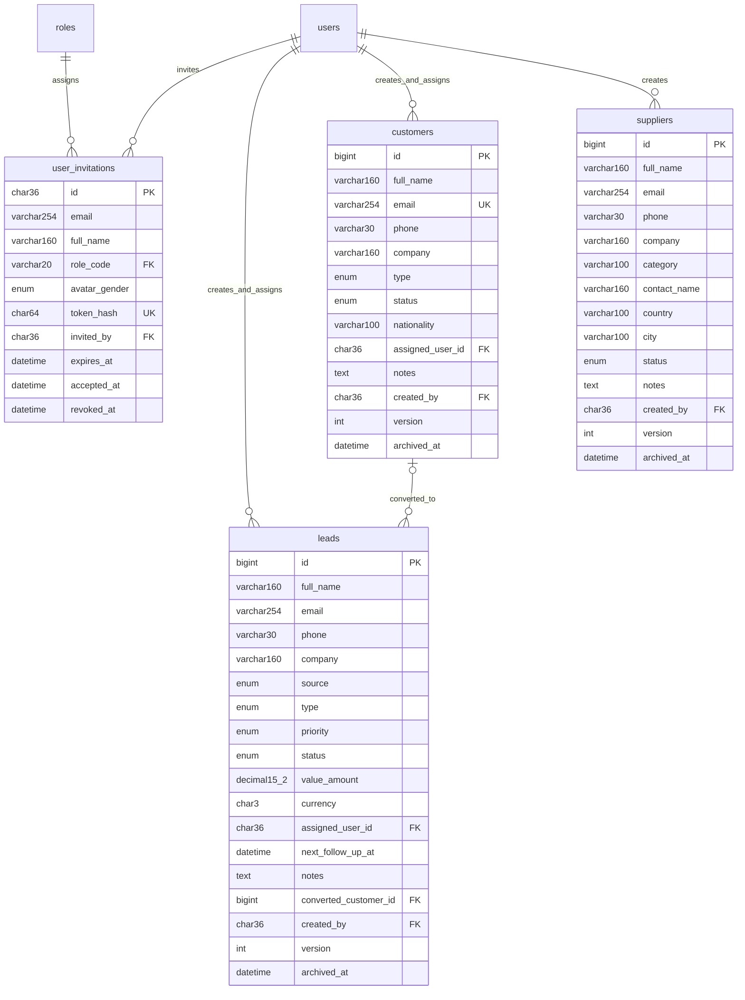
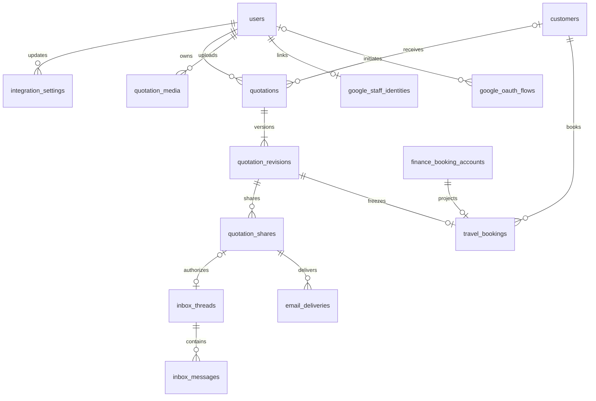

# Database model

Database is `travneeds_crm`. Local XAMPP reports MariaDB 10.4.32. The schema uses MySQL-compatible InnoDB tables, utf8mb4 text, foreign keys and explicit constraints. Initial migration is `docs/database/migrations/001_foundation.sql`.

## Implemented foundation

## Constraints and state

| Table | Ownership and invariant |
| --- | --- |
| users | Authentication/user management. Unique email, UUID identifier, versioned password hash, active/disabled status |
| roles | Technical codes `admin` and `employee` |
| user_roles | Composite primary key prevents duplicate assignments |
| auth_sessions | SHA-256 token digest, CSRF token, absolute 8-hour expiry, FK to user, expiry/user indexes |
| audit_events | Actual login, logout, bootstrap and settings events. Nullable actor preserves events if an account is removed |
| project_settings | Singleton id 1, optimistic version increments with each saved change |
| currency_rates | Positive DECIMAL(20,8), distinct base/quote currencies, real source and effective date, author FK |
| installation_license | Singleton id 1, starts inactive with nullable plan/digest/dates. An active record requires plan, digest and valid dates |
| schema_migrations | Immutable migration version and content checksum |

The migration inserts the two role codes, the actual default project identity, and an inactive license record. It inserts no users, sessions, exchange rates or business records. USD is the initial base-currency configuration and can be changed by an administrator.

Currency-rate ingestion/conversion, serial issuing, activation verification, renewal and license enforcement are deferred. No endpoint currently changes licensing status. The raw activation serial is absent from storage and application logs.

## CRM and account management

Leads, Customers and Suppliers now have real directory tables in migration 005. Bookings and Payments do not yet have tables. Booking ownership under a Customer, supplier participation in booked services, and payments linked to their booking/customer will be derived from the selected source workflows. Finance reports will read those persisted records when that integration is implemented.

Each module integration must add a migration and update this diagram with the actual model. Preserve optional and historical relationships explicitly. Monetary values require DECIMAL, currency codes, transaction boundaries and ownership checks. No placeholder booking or payment schema is presented as an implemented workflow.

## Operations

Migrations use a database advisory lock, statement-by-statement execution and a checksum ledger. DDL implicitly commits on MariaDB, so an interrupted migration is rerun using idempotent statements. Never edit a migration after it has been applied. The runtime account uses DML permissions on this database. Schema and account setup use the separate operational credentials.

## Account and notification restoration migration

Migration 002_account_notifications adds user_profiles and notifications with no data inserts. Profiles are created only when an actual account saves its details. A user-row lock and a profile version prevent concurrent overwrite. Full name/email are stored on users, phone is stored on user_profiles, and role/department are read-only in the account interface. Email remains unique.

Notifications belong to one user, with persistent read_at and deleted_at values. APIs enforce that ownership on every list/read/delete operation. The center shows the latest 100 non-deleted records and derives its unread count from all owned non-deleted records. No demonstration notifications are inserted.

The current schema has fifteen tables. Database health requires migrations 001–006. Booking/payment metrics remain unconfigured until their actual modules are integrated, so the dashboard displays unavailable values instead of fabricated financial totals.

## Restored modules: migrations 003–005

Migration 006 additionally restores the account detail and system-audit contracts described below.

Migration 003 stores avatar_gender (male/female) on user_profiles. Missing profiles display the original male default asset; no gender is inferred from names. Saving a profile stores the choice. Migration 004 adds users.version, users.last_login_at, user_profiles.job_title and user_invitations. Profile updates also advance users.version so concurrent administrator edits cannot silently overwrite them.

All three directory tables also store created_at and updated_at. Directory IDs are server-generated integers serialized as strings; visible LD/CUST references derive from those persisted IDs. Customers have unique non-empty email addresses. Optional empty email/contact fields are stored as NULL. Lead money is nonnegative DECIMAL(15,2), paired with an ISO currency code and transported as decimal text. No booking totals or balances are editable directory fields.

Row locks plus version checks reject stale updates with 409. Archive/restore preserves the record and increments its version. Conversion locks the lead, either links a selected existing active-directory customer or creates one, records both operations atomically, and returns the same linked customer on a retry. Assignment notifications are committed in the same transaction as the record change.

Invitations store a SHA-256 digest of a random 32-byte token, expire after 72 hours and can be revoked. A new invite for an email revokes previous outstanding invites. Acceptance locks the invitation, creates its user/role/profile atomically, and consumes it. No plaintext invitation tokens are stored in the database. Runtime user operations use the existing DML account; migrations and isolated tests use the existing operational account. No additional MySQL accounts are created for testing.

## User details and audit metadata: migration 006

No new table or seed records are introduced. user_profiles adds nullable date_of_birth DATE, nationality VARCHAR(100), address VARCHAR(500), emergency_contact_name VARCHAR(160), emergency_contact_phone VARCHAR(30) and emergency_relationship VARCHAR(60), plus gender ENUM(male, female, unspecified). Gender is optional personal information and is independent of avatar selection. The default unspecified value does not infer a person's gender. Administrator edits preserve omitted optional personal fields and participate in the existing account/profile version transaction.

auth_sessions adds nullable user_agent VARCHAR(512), captured from actual future login requests. Older rows remain NULL. Session detail responses expose creation/expiry/client text and a computed current-session boolean, never session token hashes or CSRF tokens.

audit_events adds nullable module_code VARCHAR(32), details VARCHAR(500), severity ENUM(info, warning, critical), outcome ENUM(success, failure) and request_ip VARCHAR(45). Server-owned writers classify new authentication and account-access changes. Historical events were written only for committed successes; their reader derives the module from the actual action code and uses the info/success baseline when metadata was not originally recorded. It never invents historical IPs or details. Failed sign-in entries have no authenticated actor; an existing targeted account may be referenced by entity_id. There is no client endpoint for modifying audit records or metadata.

The schema remains fifteen tables with six immutable migrations. User details derive capabilities from the enforced admin/employee policy, activity from audit_events, and performance counts from actual assigned CRM records. No user-performance ratings, completed tasks or fabricated session device descriptions are stored.

## Finance projection: migration 007

Migration 007 adds five tables, bringing the current schema to twenty tables and seven migrations. No financial business records are seeded; only the pending trips source configuration is inserted.

| Table | Relationships and invariants |
| --- | --- |
| finance_sources | Source code PK; pending/connected status and corresponding connection timestamp |
| finance_booking_accounts | Unique opaque source/key, customer snapshot, optional local customer/agent FKs, currency, totals/deposit/known costs, due/booked/synchronized dates |
| finance_booking_suppliers | Booking/supplier composite PK and FKs; multiple suppliers per booking |
| finance_invoices | Booking/currency FK, unique optional source-document key/number, party/supplier, bill-to snapshot, kind/state, amount/dates/terms/notes |
| finance_payments | Booking/currency and optional invoice/booking/currency FK; source key, receipt/refund/supplier purpose, status, amount, method/reference/settlement/operator |

Amounts use DECIMAL(18,2). Checks enforce nonnegative invoice/booking amounts, positive payments, known cost consistency, required supplier references and issuance/settlement dates. Nullable costs mean unknown. Source booking/document/payment identifiers remain separate from local bigint IDs. Only connected sources appear in read projections. No current runtime route inserts or modifies these records.

## Itemized invoices: migrations 008 and 009

The current schema contains 22 tables including schema_migrations and nine migrations. 008 makes finance_invoices.booking_id nullable, preserving composite booking/currency foreign keys for linked invoices. Manual invoices have no booking. It adds immutable issuer/customer snapshots, document date, customer reference, discount/tax/subtotal, optimistic version, creator, unique request key and digest. 009 extends legacy payment_terms to VARCHAR(2000); prior migrations remain immutable.

finance_invoice_items uses (invoice_id, position) as its primary key with an invoice FK. Description is VARCHAR(1000), positive quantity DECIMAL(9,3), nonnegative unit_price DECIMAL(12,2) and rounded amount DECIMAL(18,2). finance_invoice_counters uses year as its primary key and stores the last allocated integer under transaction row locks. No business fixtures or counter rows are seeded.

Application transactions recompute each item and total using exact integers, persist items/header/audit together and require non-empty descriptions, valid dates/currency, discount no greater than subtotal and optional tax 0–100%. Tax rounds after discount. Source-owned invoice snapshots cannot be edited through the local editor. Issued local invoices cannot be edited; number allocation and the issued audit event happen exactly once even on retry. Existing source snapshots without line details display their actual summary amount, not fabricated itemization.

## Travel, communications and provider configuration

Migrations 010–016 add provider settings, quotations, private media storage, travel bookings, Inbox, email delivery history and Google sign-in.

- `integration_settings` keeps named configuration fields and authenticated encrypted secrets. `currency_rates.version` protects edits.
- `quotation_revisions` freezes bilingual content, price and customer/brand context. It has a composite quotation/version key. Shares store a digest and expiry. Media bytes live in private filesystem storage linked by UUID metadata, with database BLOB reads for older records.
- `travel_bookings.quotation_id` is unique. Its foreign key includes the exact revision. Finance projections and supplier links are created in the same transaction. Pending/cancelled bookings are excluded from reporting via `finance_booking_accounts.is_reporting`.
- Inbox de-duplicates client requests and provider message identifiers. Web threads are linked to a share and quotation owner. Meta threads are keyed by channel/account/contact.
- Email logs store the quote/recipient/subject and acceptance status, with no SMTP credentials or share token. OAuth state and browser binding use SHA-256 digests and a ten-minute expiry. The Google identity is unique per OAuth client/subject.

## Project branding, active currencies and travel catalogue

Migrations 017–019 add immutable public branding asset bytes, the installation's enabled ISO currency codes, and the reusable travel catalogue. A catalogue entry has a kind, bilingual names, an optional catalogue slug, an edit version and active status. Room entries have a foreign key to their parent hotel. `travel_hotel_options` links hotels with meal plans, amenities and travel add-ons. `travel_catalogue_media` grants authenticated staff use of the selected private media files. Catalogue prices and costs use DECIMAL and carry their own currency. Quotes retain their saved descriptions, names and amounts alongside selected catalogue IDs in the revision. Creating missing catalogue records and saving the quote occur in one transaction.
